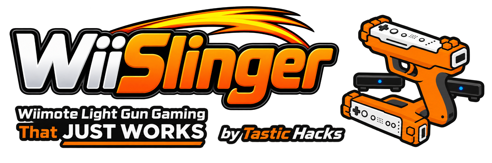
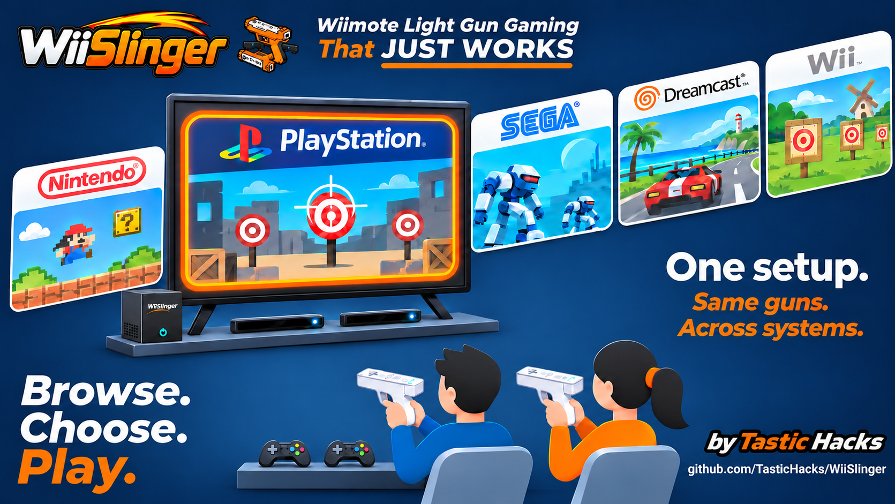
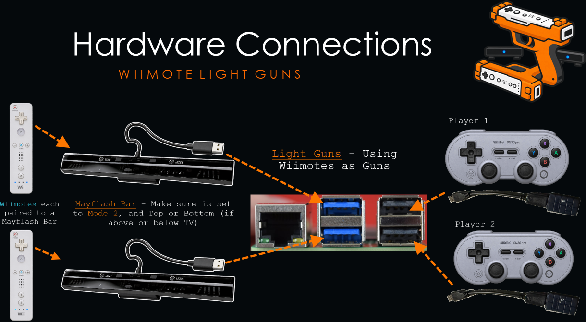

# WiiSlinger - Universal Light Gun Game Setup

The WiiSlinger project is our unified effort at organizing the files and guidance for creating this single universal light gun retrogaming setup across all emulators.  This is where you’ll be able to find the configuration files we’ll be referencing in our videos and other helpful materials.

For the hardware, you’ll need 2 Wiimote controllers and 2 Mayflash Dolphinbar receivers set to “Mode 2” (one dedicated to each Wiimote).  Note, I recommend using an official Wii Wiimote (which will have the “Wii” logo at the bottom on the controller).  I’ve heard generic Wiimote hardware copies tend to be problematic.  

This diagram illustrates the connections for our RetroPie setup on the Raspberry Pi 5.  Note, I also use 8bitdo’s SN30 Pro controllers as my primary controller for retrogaming, and I’ll speak to that more here in a bit.

## 🎬 Videos - WiiSlinger Guides
* [Tastic Hacks - YouTube.com](http://www.youtube.com/@TasticHacks)

